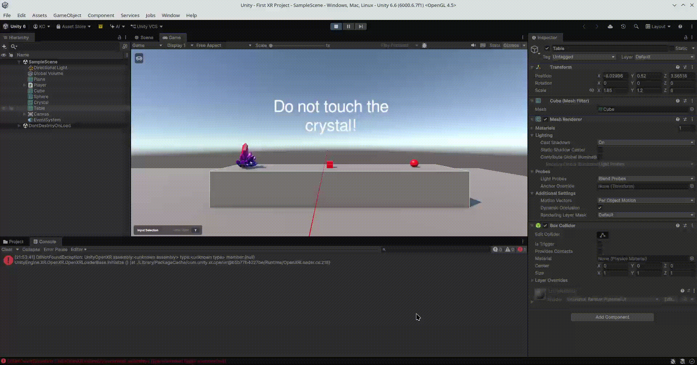

Se ha creado un entorno virtual con un personaje que puede
ser controlado utilizando mandos. Se utilizan los sticks
de los mandos para desplazarse. Tambien se permite interactuar
con dos tipos de objetos:
- Cuando el personaje interactua con el cristal, se cambia
  el texto en el UI configurado en el world space.
- Cuando el personaje interactua con el cubo o la esfera,
  su material cambia de color.

Estas funcionalidades se han implementado a traves de eventos
que proporciona XR Interaction Toolkit.

